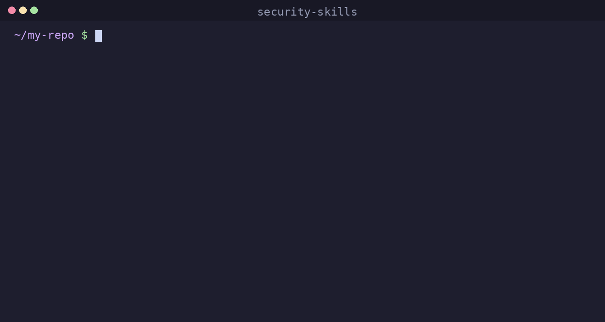

# security-skills

Agent skills that catch leaked keys, personal data and risky dependencies before your repo or site goes public.



Works with Claude Code, Cursor, Codex, Copilot, OpenCode and any agent that reads `SKILL.md`.

## Install

```bash
npx skills add karix-ai/security-skills
```

Then, inside your project:

```
> run a security audit on this repo
> I'm about to make this public, check it
> I think I pushed my API key
```

The agent loads the matching skill and does the work. Install one skill only with `--skill secrets-scan`.

## Why

AI agents made it easy to ship. They also made it easy to ship your keys.

- **28.65 million** new hardcoded secrets hit public GitHub in 2025, up 34% in a year.
- Commits made with Claude Code leaked secrets at **3.2%**, against a **1.5%** baseline across all public commits.
- **24,008** unique secrets were exposed in MCP config files alone.
- Over **64%** of credentials leaked in 2022 were **still valid** in January 2026. Nobody rotated them.

Sources: [data/security-stats.md](data/security-stats.md) (GitGuardian, State of Secrets Sprawl 2026).

The fixes are not hard. They are just easy to forget at 2 am before a launch. These skills make your agent check them by default, and tell you exactly what to do when something is wrong.

## Skills

| Skill | What the agent does |
|---|---|
| `security-audit` | Scores the repo 0–100 and lists what to fix first. **Run this first.** |
| `secrets-scan` | Scans the working tree and full git history with gitleaks/trufflehog, triages real leaks from noise. |
| `leak-response` | When a key leaked: rotate first, check for abuse, then clean history. In that order. |
| `git-identity-hygiene` | Finds your personal email in commits, GPS in photos, local paths and names in code. |
| `dependency-audit` | Known CVEs plus the signs of a malicious package: typosquats, install scripts, new publishers. |
| `github-hardening` | 2FA, push protection, Dependabot, branch rules, and read-only, SHA-pinned Actions. |
| `agent-tooling-safety` | Reviews MCP servers, extensions and skills before you trust them; scopes agent permissions. |
| `website-security` | HTTPS, security headers, forms, cookies, and API keys hiding in your frontend bundle. |
| `pre-publish-check` | The final go / no-go before a repo goes from private to public. |

## Example

Illustrative output on a sample project:

```
> run a security audit on this repo

Security score: 58/100

Fix first:
- [STOP] Verified OpenAI key in .env.production (commit 4f2a9c1), sk-p…9xQa → leak-response, now
- [10] 1 high severity advisory in a production dependency, patch release available → dependency-audit (2 min)
- [6]  12 commits authored with personal@gmail.com → git-identity-hygiene (10 min)
- [5]  release.yml has no permissions block (token defaults to write) → github-hardening

Already good: lockfile committed, LICENSE present, 2FA on.
Next: revoke the OpenAI key at platform.openai.com, then rerun.
```

## What it is not

Not a penetration test and not a replacement for a security review of a production system. It is the checklist that stops the common, embarrassing, expensive mistakes. It never prints full secret values and never pushes or rewrites history without asking.

## Also from karix-ai

[launch-skills](https://github.com/karix-ai/launch-skills): agent skills that launch your open-source repo. Run `pre-publish-check` first, then launch.

## Contributing

Each skill is a folder under `skills/` with a `SKILL.md`. Better commands, new providers in the rotation table, and new incident patterns (with a source) are welcome. See [CONTRIBUTING.md](CONTRIBUTING.md). Found a problem in the skills themselves? See [SECURITY.md](SECURITY.md).

## License

MIT
